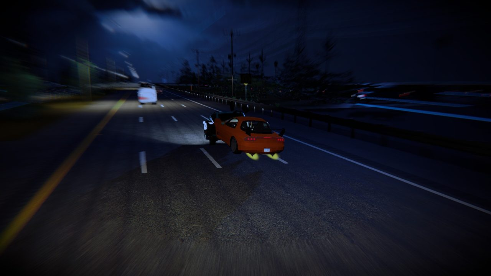
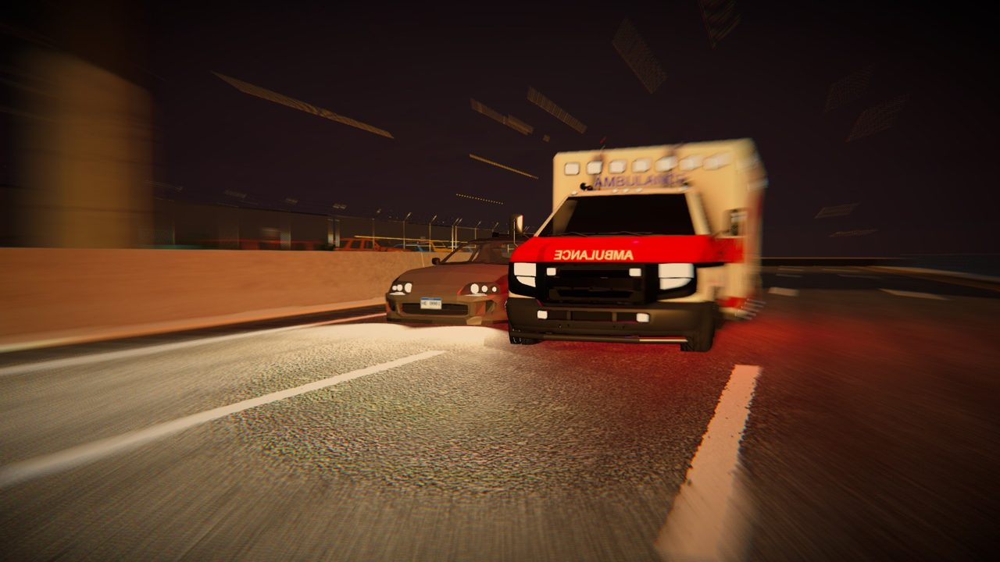
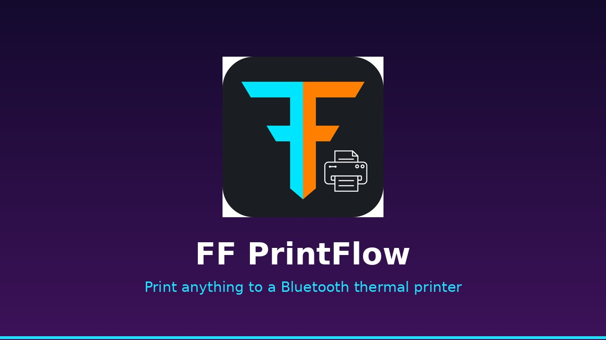
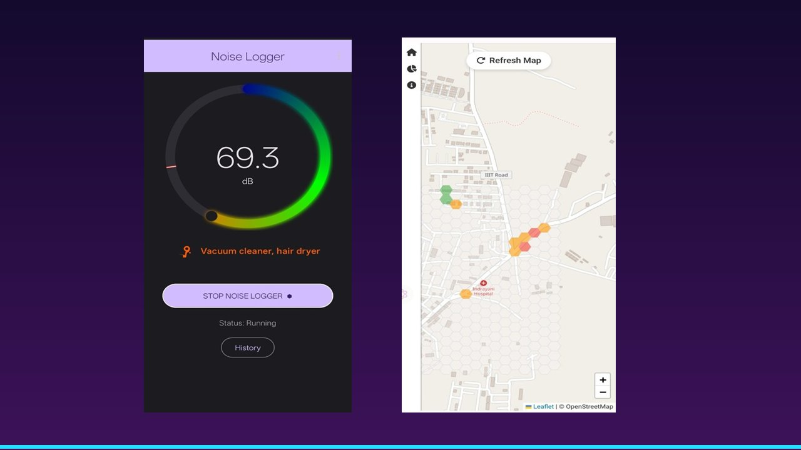

  

  
  
  

  
  

---

## 🏎️ Horizon's Edge &nbsp;·&nbsp; Fundless Studio

  

<table>
  <tr>
    <td width="50%"></td>
    <td width="50%"></td>
  </tr>
</table>

An endless, one-thumb highway racer for Android. Weave through traffic at dusk; the closer you pass, the more you score.

- 🎮 **Designed and directed end to end**: near-miss scoring, gesture controls, a 16-car fleet and a six-district drive from downtown to the ocean
- 📱 **Built for cheap phones**: three quality tiers hold 30–60 fps on low-end Android
- 🚀 **Built to ship**: automated tests, Google Play Games, licence-checked assets

  
  
  
  

---

## 🧩 Things I've shipped

<table>
  <tr>
    <td width="33%" valign="top">
      
      <h3><a href="https://github.com/FerretyCobra/InternetSeparator">Internet Separator</a></h3>
      Run Wi-Fi, Ethernet and USB tethering at the same time and choose which app uses which.  
      
      
      
    </td>
    <td width="33%" valign="top">
      
      <h3><a href="https://github.com/FerretyCobra/MyThermalPrint">FF PrintFlow</a></h3>
      Print anything from Android to a Bluetooth thermal printer. Three dithering modes, server-side licensing.  
      
      
      
    </td>
    <td width="33%" valign="top">
      
      <h3><a href="https://github.com/FerretyCobra/Noise_Logger">NoiseLogger</a></h3>
      A crowdsourced noise map: live dB meter, 87 dB safety alerts and hotspot detection.  
      
      
      
    </td>
  </tr>
</table>

---

## 🏢 At FrostFire Tronics

Company code is private. These are the products I build and look after.

| | Product | What I do on it |
|:-:|---|---|
| 🧾 | **FF Billing** | Leading the eight-phase rewrite from Xamarin.Forms to Flutter |
| 🛡️ | **FGS Guard** | Redesigned the gate-guard tablet app: 20+ screens, new motion |
| 🏋️ | **Gym Management** | Built it end to end: Flutter desktop, Flask API, hardware-locked licences |
| 📊 | **FF Tracker** | Self-hosted tracker that works out time spent from an event log |
| 🎫 | **FF Token** | Token and POS dashboard for counters and restaurants |
| 🏘️ | **Society Admin** | 19-screen society management app with role-based access |

Before this I was the sole developer of a data-capture platform for a national **ICMR** hospital study at ICMR-NITVAR, Pune.

---

## 🛠️ Toolbox

  

---

  <b>Open to software engineering roles · Mumbai, India · open to relocation</b>

