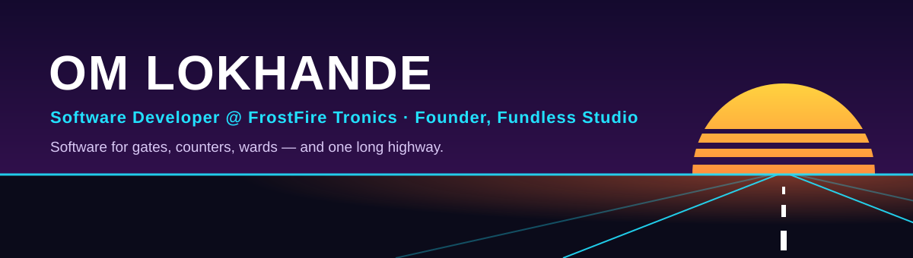
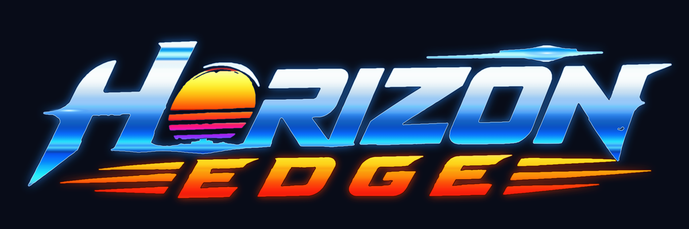

  <a href="https://linkedin.com/in/om-lokhande">LinkedIn</a> ·
  <a href="mailto:Omlokhande04@gmail.com">Omlokhande04@gmail.com</a> ·
  Pune, India

I'm Om. I build software that has to work in the real world: a guard's tablet at a society gate when the internet is down, a Bluetooth printer halfway through a long receipt, a hospital study where a paper form used to lose data.

By day I'm a Software Developer at **FrostFire Tronics**. The rest of the time I run **Fundless Studio** and build a highway racer.

## Where my code runs

| Where | What I built | With |
|---|---|---|
| **At a society gate** | FGS Guard, the tablet app guards use at the gate. It talks to a Raspberry Pi over local Wi-Fi and keeps working offline. I redesigned all 20+ screens. | Flutter |
| **At a shop counter** | FF Billing (I'm leading its rewrite from Xamarin.Forms to Flutter), FF Token for queues and POS, and [FF PrintFlow](https://github.com/FerretyCobra/MyThermalPrint) for thermal printing, in public beta on Google Play | Flutter · Java |
| **In a national hospital study** | The data-capture platform for an ICMR study at ICMR-NITVAR, Pune. I was the only developer, from requirements to sign-off. | React · Firebase |
| **At the gym** | A desktop gym suite with hardware-locked licensing and a one-click offline installer | Flutter · Flask |
| **On your PC** | [Internet Separator](https://github.com/FerretyCobra/InternetSeparator): run Wi-Fi, Ethernet and USB tethering together and pick which app uses which | C# · WPF |
| **On city streets** | [NoiseLogger](https://github.com/FerretyCobra/Noise_Logger), a crowdsourced noise map with 87 dB safety alerts. Copyright granted. | Java · PHP |
| **On the highway** | Horizon's Edge ↓ | Unity · C# |

FrostFire and ICMR code is private, so those rows have no links.

## Horizon's Edge

An endless, one-thumb highway racer for Android. You weave through traffic at dusk, and the closer you pass, the more you score. **Entering Google Play internal testing.**

- I designed and directed it: near-miss scoring, gesture controls, a 16-car fleet and a six-district drive from downtown to the ocean, tuned through playtests on real phones
- It runs on cheap phones: three quality tiers keep it at 30–60 fps, checked in Unity Profiler
- It's built to ship: automated tests, Google Play Games, and a licence check on every 3D asset in the build

## Right now · October 2026

- Getting the Horizon's Edge internal-testing build out
- Moving FF Billing off Xamarin.Forms, one phase at a time
- Rolling out the new FGS Guard design and motion

## Toolbox

- **Daily:** Flutter, Dart, Python, Java, C#
- **Backend:** Flask, FastAPI, Fastify, SQLAlchemy, MySQL, PostgreSQL, Firebase
- **Games:** Unity, Blender
- **Hardware:** Raspberry Pi, Bluetooth ESC/POS printers

---

B.E. Computer Engineering, Honours in Data Science · Dr. D. Y. Patil College of Engineering & Innovation, 2026 
Open to software engineering roles · Pune, open to relocation
